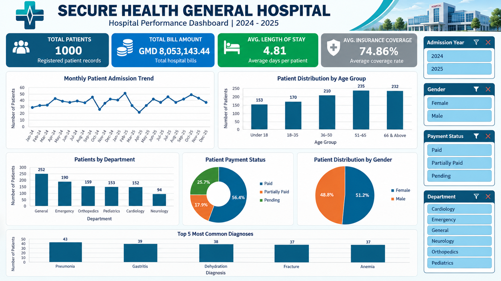
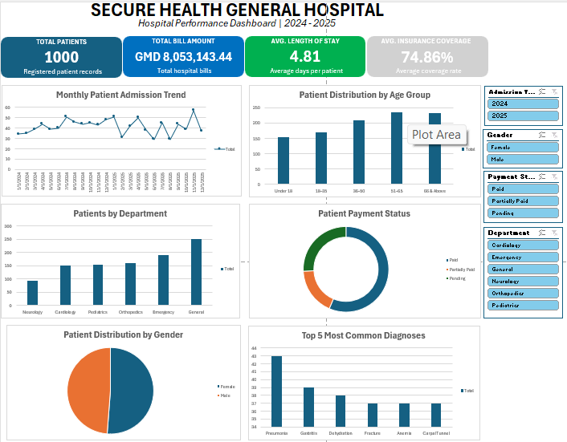

# SECURE HEALTH GENERAL HOSPITAL
## Hospital Performance Dashboard | 2024–2025

An interactive hospital performance dashboard developed using Microsoft Excel to analyse hospital admissions, patient demographics, departmental workload, payment status, insurance coverage and diagnosis patterns.

## 1. Introduction

This project demonstrates how Microsoft Excel can be used to transform healthcare data into meaningful visual insights for hospital performance monitoring and management reporting.

The dashboard provides an overview of hospital operations, helping decision-makers explore admission trends, patient demographics, departmental activity and financial indicators.

## 2. Dataset Overview

The analysis is based on a classroom dataset containing 1,000 patient records covering 2024 and 2025.

The analysis considers:
- Patient demographics
- Admission dates and trends
- Hospital departments
- Diagnoses
- Billing and payment status
- Insurance coverage
- Length of hospital stay

**Privacy notice:** The original patient-level dataset is not included in this repository. The published Excel workbook contains aggregated analysis and dashboard information only.

## 3. Problem Statement

Hospital management needs a clear and accessible way to monitor patient admissions, understand departmental workload and review financial performance.

Without an organised reporting system, identifying operational patterns and making informed decisions can be difficult.

This project addresses that challenge through an interactive Excel dashboard.

## 4. Tools and Methodology

**Tools used:**
- Microsoft Excel
- PivotTables
- PivotCharts
- Excel slicers
- Excel formulas
- Data cleaning and analysis

**Methodology:**
1. Reviewed and cleaned the dataset.
2. Created calculated fields and key performance indicators.
3. Developed PivotTables for different analysis categories.
4. Created interactive charts and connected slicers.
5. Designed a consolidated performance dashboard.

## 5. Dashboard Visualisation

The dashboard presents six major analytical areas:
- Monthly admission trends
- Patient distribution by age group
- Departmental patient distribution
- Payment status analysis
- Gender distribution
- Top five recorded diagnoses

## 6. Key Performance Indicators

| KPI | Result |
|---|---:|
| Total Patients | 1,000 |
| Total Bill Amount | GMD 8,053,143.44 |
| Fully Paid Bill Value | GMD 4,568,527.32 |
| Average Length of Stay | 4.81 days |
| Average Insurance Coverage | 74.86% |

## 7. Key Insights

- A total of 1,000 patient records were analysed.
- Female patients accounted for 512 records, while male patients accounted for 488.
- The 51–65 age group recorded the highest patient count.
- General Medicine recorded the highest departmental patient count.
- 564 records were classified as fully paid, 179 as partially paid and 257 as pending.
- Pneumonia was the most frequently recorded diagnosis among the five leading diagnoses.

## 8. Recommendations

1. Monitor monthly admission patterns to support resource planning.
2. Review departmental workloads to improve staff and resource allocation.
3. Strengthen follow-up procedures for pending and partially paid bills.
4. Use demographic trends to support patient-centred service planning.
5. Continue monitoring key performance indicators through regular reporting.

## 9. Conclusion

The Secure Health General Hospital Performance Dashboard demonstrates how Excel's data analysis and visualisation capabilities can support healthcare performance monitoring.

By combining KPIs, PivotTables, PivotCharts and interactive slicers, the project provides a structured overview of hospital operations and financial indicators.

## 10. Project Files

The repository contains:

- `SECURE_HEALTH_DASHBOARD/Secure_Health_Dashboard.xlsx` — Privacy-safe Excel dashboard workbook.
- `SECURE_HEALTH_DASHBOARD/Dashboard_Image.png` — Dashboard screenshot.
- `SECURE_HEALTH_DASHBOARD/Introductory_Image.png` — Introductory project image.
- `SECURE_HEALTH_DASHBOARD/GitHub_ReadMe_File (1).docx` — Project documentation.

---

**Project:** Secure Health General Hospital Performance Dashboard  
**Period Analysed:** 2024–2025  
**Tool:** Microsoft Excel  
**Project Type:** Healthcare Data Analysis and Visualisation
